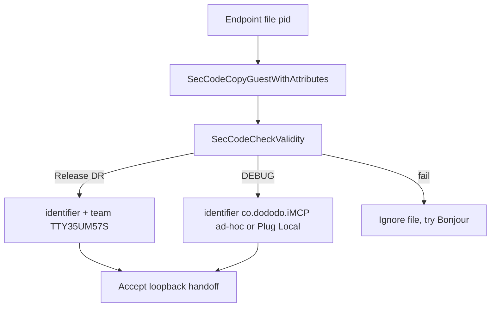
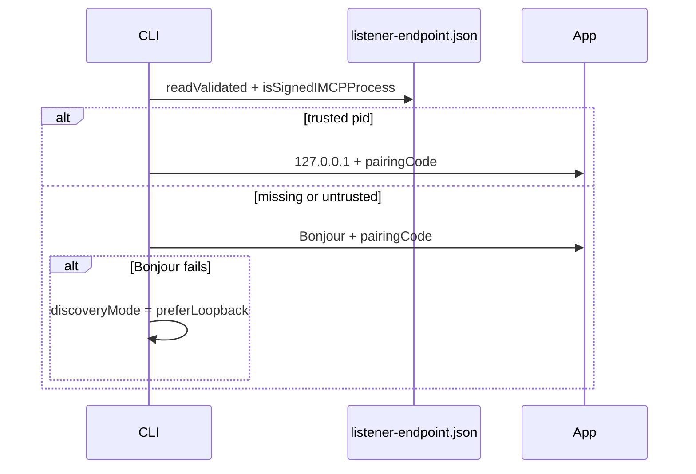

# Review Trust and Contract Fixes - Plan

## Goal Capsule

- **Objective:** Same-user defaults writes cannot inject pairing fingerprints, Release builds reject non-Team-ID listener pids, and MCP clients get honest pairing, date, error, and tool results.
- **Means:** Fix the validated whole-codebase review set in trust-first order (KTD2, KTD3).
- **Authority:** This plan. `AGENTS.md` for commands and paths. Review report is evidence, not a second contract.
- **Execution profile:** Characterization tests around existing pairing, auth, FetchPolicy, and CLI bootstrap suites, then the behavior change.
- **Stop conditions:** A required identity pin that rejects the Debug test host or `Scripts/install-local.sh`. A Keychain write that deletes a real item on a transient error. Growing `CLAUDE.md` into a second instruction body.
- **Tail ownership:** `ce-work` after this plan is implementation-ready.

---

## Product Contract

### Summary

Close the validated pairing, TCC, date-filter, MCP-error, and tool-result defects from the whole-codebase review.
Keep `AGENTS.md` as the only instruction body.
Do not add tools, CRUD, or `imcp_status`.

### Problem Frame

The current tree can import attacker fingerprints from `UserDefaults` whenever the Keychain item is missing, and the CLI can treat a same-user pid with a spoofed bundle id as the app.
`--pair` is dropped on the documented Bonjour fallback, Capture Grant can mark success with no TCC grant, and several tools return silent defaults or shared errors that agents cannot distinguish.

### Key Decisions

- **AGENTS.md is the only instruction body.** `CLAUDE.md` stays a pointer. (session-settled: user-directed — chosen over CLAUDE.md as source or dual bodies: operator required AGENTS.md as the main file.) Governs R25.

### Requirements

#### Trust and pairing

- R1. An empty or never-migrated pairing store must not import a later `UserDefaults` `pairedClients` write.
- R2. Release `isSignedIMCPProcess` must accept only a process that satisfies the Release designated requirement, not an Info.plist `CFBundleIdentifier`. Debug may still accept ad-hoc or Plug Local Signing with identifier `co.dododo.iMCP` (KTD2).
- R3. Debug and `Scripts/install-local.sh` ad-hoc builds with identifier `co.dododo.iMCP` must still pass the signed-process check.
- R4. Release builds must require identifier `co.dododo.iMCP` and Team ID `TTY35UM57S`.
- R5. An AUTH-RESPONSE with an out-of-range pairing-code length must not parse as an unpaired success and must not leave leftover bytes for the MCP scanner.
- R6. CLI `--pair` and `IMCP_PAIR_CODE` must apply on loopback and Bonjour.
- R7. CLI Network parameters must require the loopback interface, matching `NetworkDiscoveryManager.makeParameters()`.
- R8. After a Bonjour connect or discover failure, discovery must return to loopback-first.
- R9. If `--pair` and `IMCP_PAIR_CODE` are both set and disagree, the CLI must exit with an error. If they agree, use that value.

#### Capture and dates

- R10. Capture Grant must not report granted unless camera, microphone, or Screen Recording is already granted.
- R11. Capture `activate()` must not prompt for Screen Recording.
- R12. A present, unparseable date argument must fail the tool call. An omitted date stays an optional default.
- R13. Date keys `start`/`end` and `startDate`/`endDate` must be accepted where those names already appear in tool schemas.

#### MCP contract

- R14. Unknown tool name and disabled service must return different CallTool error texts.
- R15. Non-UTF-8 tool JSON must be an error, not a success `{}`.
- R16. Approval denial must not be reported as `MCPError.connectionClosed`.
- R17. A receive buffer over 1 MB must cancel the `NWConnection`.

#### Tool results and UI

- R18. `maps_directions` `transportType` `any` must use `MKDirectionsTransportType.any`.
- R19. `events_fetch` must apply a documented `limit` with the shared FetchPolicy hard cap of 500.
- R20. `contacts_update` must accept the search result `@id` as well as `identifier`.
- R21. `photos_fetch_image` must request a scaled image, not the original bytes.
- R22. A nil EventKit reminders fetch must fail. An empty list must succeed as `[]`.
- R23. A Screen Time end-only range must be a window ending at that end, not `now-7d` that can sit after the end.
- R24. Pair and About must each keep one window. Menu actions must be Buttons. The Grant control must have an accessibility label.
- R25. Instruction edits go only in `AGENTS.md`. `CLAUDE.md` stays a pointer.

### Actors

- A1. Human operator: menu toggles, Grant, pair/deny, TCC dialogs.
- A2. MCP client via `imcp-server`.
- A3. Same-user local attacker who can write defaults or an endpoint file.

### Key Flows

- F1. CLI connects loopback-first, then Bonjour, carrying the pairing code on both (R6, R7, R8).
- F2. Human Grant on Capture stays reachable after a failed first toggle-on, opens System Settings, and reports granted only when a real TCC grant exists (R10, R11).
- F3. Agent CallTool gets a distinct error for unknown vs disabled vs bad date vs deny (R12, R14, R16).

### Acceptance Examples

- AE1. Covers R1. Keychain missing and UserDefaults empty, then a later `defaults write` of `pairedClients`, must not add a trusted fingerprint.
- AE2. Covers R2. A live pid whose Info.plist says `co.dododo.iMCP` but that fails `SecCodeCheckValidity` must be rejected.
- AE3. Covers R5. AUTH-RESPONSE with pairing-code length 1 or 20 must not decode as unpaired success; leftover bytes must not be scanned as MCP.
- AE4. Covers R6. `--pair ABCD23` on a Bonjour session must present that code.
- AE5. Covers R12. `startDate: "not-a-date"` must error. Omitting `startDate` must keep the tool default window.

### Success Criteria

- Debug `xcodebuild test` for `iMCP` and `imcp-serverTests` still passes, including `testAppTestHostIsSignedAsIMCP`.
- A later `UserDefaults` `pairedClients` write cannot add a trusted fingerprint after the empty Keychain sentinel (AE1).
- A live pid with a spoofed Info.plist identifier fails the Release signed-process check (AE2).
- Agents can tell unknown tool, disabled service, bad date, and deny apart by error text.
- `CLAUDE.md` remains a pointer.

### Scope Boundaries

#### In scope

- Validated review findings #1, #2, #8, #11, #18, #20, #22, #24–#38.
- Persist the working-tree `AGENTS.md` body and `CLAUDE.md` pointer.

#### Deferred to Follow-Up Work

- `imcp_status`, calendar/reminders CRUD, notes body search, MCP Resources, per-client service scoping.
- Consume-on-validate pairing, CLI signing any AUTH-CHALLENGE, App Sandbox, plaintext loopback.
- New `docs/solutions/` entries for Keychain sentinel and designated-requirement pin (write after ship if useful).

#### Outside this product's identity

- Automating TCC prompts, pairing clicks, or Keychain dialogs.
- Re-applying historical plans 005 or 035 that invert the instruction pointer.

### Sources

- Whole-codebase review: `/tmp/compound-engineering-501/ce-code-review/20260821-160226-7e8976ce/report.md` (host scratch; findings copied into this contract).
- `docs/solutions/conventions/agents-md-is-source-of-truth.md`
- `App/Controllers/PairedClientStorage.swift`, `App/Shared/ListenerEndpointFile.swift`, `CLI/MCPService.swift`, `CLI/main.swift`, `App/Models/FetchPolicy.swift`

---

## Planning Contract

### Assumptions

- A present-but-unparseable date throws. Calendar `events_fetch` and Reminders fetch move onto `FetchPolicy` so R12 applies there too.
- `--pair` and `IMCP_PAIR_CODE` conflict fails closed (R9). Existing `CLIBootstrapTests` that encode env-wins must change.
- Capture `activate()` throws when no camera, mic, or Screen Recording grant exists, but the service stays enabled so the Grant control remains visible. Grant opens System Settings. Snap the toggle off only for hard activate failures that are not a missing first-time grant. No Screen Recording prompt (R11).
- Bonjour carries the pairing code (R6). The product does not refuse pairing on Bonjour.
- External Security.framework docs were still in flight at plan-write. Approach uses current `SecCodeCopyGuestWithAttributes` plus `SecCodeCheckValidity`. A 2026 replacement API is an implementation-time swap only if the current pair is gone.

### Key Technical Decisions

- KTD1. Instruction edits go only in `AGENTS.md`. `CLAUDE.md` stays the three-line pointer. (session-settled: user-directed — chosen over CLAUDE.md as source or dual bodies: operator required AGENTS.md as the main file.) Instantiates the Key Decision that Governs R25.
- KTD2. Release success is only `SecCodeCheckValidity` against identifier `co.dododo.iMCP` and Team ID `TTY35UM57S`. Remove both the `kSecCodeInfoIdentifier` equality early-return and the plist `CFBundleIdentifier` fallback from the Release path. Debug (`#if DEBUG`) accepts ad-hoc or Plug Local Signing when the identifier is `co.dododo.iMCP`. That Debug hole is accepted so the test host and `Scripts/install-local.sh` keep loopback. Rejected: identifier-only in Release and Team-ID-only everywhere. Governs R2, R3, R4.
- KTD3. Keychain load returns `.missing`, `.data(Data)`, or `.failed(OSStatus)`. Treat only `.missing` (`errSecItemNotFound`) as empty for sentinel and migrate. `all` / `add` / `remove` / `reset` must return or throw without `keychainSave` when load is `.failed`. Write encoded `[]` only when the item is missing and UserDefaults is empty. After a successful one-time migrate, persist the migrated payload. Rejected: a UserDefaults “migrated” flag and treating every nil load as missing. Governs R1.
- KTD4. Extract CLI `NWParameters` to a testable helper that matches `NetworkDiscoveryManager.makeParameters()`. Pass `pairingCode` on both resolved endpoints. Reset `discoveryMode` to `.preferLoopback` after Bonjour failure. Governs R6, R7, R8.
- KTD5. `AuthResponseFrame.from` returns nil for an out-of-range length. Both scanners must `disconnect()` on a complete AUTH-RESPONSE whose pairing-code length is outside 6–8 and must not scan remaining bytes as MCP. Do not consume an attacker-controlled claimed length. Governs R5.
- KTD6. `FetchPolicy.parseDate` / `parse` throw when a key is present and unparseable (including empty or whitespace), and read `start`/`end` as aliases of `startDate`/`endDate`. Calendar and Reminders use that parser for validation and aliases only. After a successful parse, Calendar keeps its omitted-date window (now through now+1 week) and date-only omitted-start rule. When `limit` is omitted, cap at 500, not FetchPolicy’s default 30. Screen Time end-only uses `end-7d..<end`. Rejected: replacing Calendar’s fetch contract with a raw `FetchPolicy.parse` default. Governs R12, R13, R19, R23.
- KTD7. Split the CallTool guard into unknown-name vs known-but-disabled. Non-UTF-8 JSON is `isError: true`. Deny throws a distinct `MCPError`, writes it to the client, then closes the app socket. `StdioProxy` treats a close before a successful initialize as a non-terminal connect failure (retry), not `StdioProxyError.connectionClosed`. Overflow calls `disconnect()`. Rejected: keeping the combined error string and a full new error taxonomy. Governs R14, R15, R16, R17.

### High-Level Technical Design

Signing and pairing fail closed. Debug identity is a documented exception so local builds keep loopback.





### System-Wide Impact

`App/Shared/` compiles into the app and the CLI. U1 and U4 change both targets at once.
`FetchPolicy` is shared by Messages, CallHistory, BrowserHistory, Notifications, Photos search, and Screen Time. U6’s throw-on-unparseable applies to those callers, not only Calendar.
CLI `parameters` in `CLI/main.swift` are shared by loopback connect and the Bonjour browser. The loopback pin (R7) is intentional: LAN peers named iMCP become unreachable.
CallTool error text and deny-vs-`connectionClosed` are agent-visible contracts. Hosts that match the old combined string will break.
Pairing codes remain bearer tokens in argv and env. This plan does not add a secrets store.

### Sequencing

U1 before U3, because Bonjour pairing is worthless if the endpoint file is spoofable.
U2 can run beside U1.
U4 and U7 both touch `NWConnectionTransport`. Land U4’s frame reject before U7’s overflow `disconnect()`, or do them in one pass on that file.
U3 and U7 both touch `CLI/MCPService.swift`. Land U3’s pairingCode and discovery reset before U7’s deny mapping, or do them in one pass on that file.
U5, U6, U8, and U9 after the trust units.

### Risks

- Debug KTD2 still accepts a same-user ad-hoc process signed as `co.dododo.iMCP`. Release rejects non-Team-ID pids. That Debug hole is accepted so `install-local.sh` and the test host keep loopback.
- A Team-ID-only pin breaks Debug tests and `install-local.sh` (mitigate KTD2).
- Sentinel write on any `keychainLoad() == nil` can delete a real item if load failed for a reason other than not-found (mitigate KTD3).
- `return nil` from `AuthResponseFrame.from` without scanner changes leaves the whole AUTH-RESPONSE in the buffer (mitigate KTD5).
- Distinct deny must not be `connectionClosed` or the CLI exits as if the session had started (mitigate KTD7).
- Hosts that match the old combined tool-error string will break. New strings are the contract.

---

## Implementation Units

### U1. Pin listener-endpoint process identity

- **Goal:** Only a real iMCP-signed pid can publish the loopback handoff.
- **Requirements:** R2, R3, R4. KTD2.
- **Dependencies:** None.
- **Files:** `App/Shared/ListenerEndpointFile.swift`, `iMCPTests/ListenerEndpointFileTests.swift`, `Scripts/verify-app-signing.sh` (only if the debug exception comment must match).
- **Approach:**
  1. Keep pid → `SecCodeCopyGuestWithAttributes` → static code.
  2. Compile a `SecRequirement` and call `SecCodeCheckValidity`.
  3. Release requirement per KTD2. Debug exception per KTD2.
  4. On the Release path, remove the `kSecCodeInfoIdentifier` equality early-return and the plist `CFBundleIdentifier` fallback.
- **Patterns to follow:** Existing guest-code lookup in `isSignedIMCPProcess`. `Scripts/verify-app-signing.sh` already allows missing DR when `IMCP_ALLOW_ADHOC=1`.
- **Test scenarios:**
  - Happy path: `testAppTestHostIsSignedAsIMCP` still passes on the Debug host.
  - Edge: pid 0 and -1 stay false.
  - Error: injected `isTrustedProcess: false` still rejects `readValidated`.
  - Error: document that a spoofed-plist pid cannot be constructed in-process; the plist branch must be gone so the check cannot succeed on plist alone.
- **Verification:** Debug app tests pass. Release requirement string includes `TTY35UM57S`.
- **Execution note:** Keep characterization of `testAppTestHostIsSignedAsIMCP` red if the Debug exception is omitted.

### U2. Keychain empty-store sentinel

- **Goal:** Missing Keychain plus empty UserDefaults becomes a stored empty list, so a later defaults write cannot migrate in.
- **Requirements:** R1. KTD3.
- **Dependencies:** None.
- **Files:** `App/Controllers/PairedClientStorage.swift`, `iMCPTests/PairedClientStoreTests.swift`.
- **Approach:**
  1. Change the load seam to `.missing` / `.data` / `.failed` per KTD3.
  2. If missing and UserDefaults empty, save encoded `[]`.
  3. If missing and UserDefaults has a payload, keep the existing read-back migrate.
  4. If load is `.failed`, do not save or delete on migrate, `all`, `add`, `remove`, or `reset`.
- **Patterns to follow:** `ClientKeyStore` already branches `errSecItemNotFound` vs other statuses. Widen `PairedClientStoreTests` injection to the three-way result.
- **Test scenarios:**
  - Happy path: empty defaults + `.missing` writes `[]`.
  - Edge: later UserDefaults payload with existing `[]` item does not import.
  - Error: failed save still leaves UserDefaults (existing test).
  - Error: `.failed` on migrate, add, remove, and reset does not call save/delete.
- **Verification:** New sentinel tests plus existing migrate tests pass.

### U3. CLI loopback pin, Bonjour pairing, discovery reset

- **Goal:** The CLI stays on this Mac, keeps `--pair` on Bonjour, and retries loopback after Bonjour fails.
- **Requirements:** R6, R7, R8, R9. KTD4.
- **Dependencies:** U1.
- **Files:** `CLI/main.swift`, `CLI/MCPService.swift`, `CLI/CLIBootstrap.swift`, `CLITests/CLIBootstrapTests.swift`, a small testable parameters helper if extracted (same pattern as `NetworkDiscoveryManager.makeParametersForTesting()`).
- **Approach:**
  1. Shared CLI parameters get `requiredInterfaceType = .loopback`.
  2. `sessionPairingCode` is the constructor `pairingCode` on both endpoint cases.
  3. After Bonjour connect or discover failure, set `discoveryMode` to `.preferLoopback`.
  4. `resolvedPairingCode`: if env and `--pair` both present and differ, `exit(1)`; if they match, use the value; if only one is set, use that one.
- **Patterns to follow:** `NetworkDiscoveryManager.makeParameters()` comments on `acceptLocalOnly`. `StdioProxy` already accepts a code on any endpoint.
- **Test scenarios:**
  - Happy path: `--pair` alone and env alone still resolve.
  - Edge: both set to the same code succeeds.
  - Error: both set to different codes fail (do not silently prefer env).
  - Integration: parameters helper asserts `requiredInterfaceType == .loopback`.
- **Verification:** `imcp-serverTests` pass. MCPService pairing-on-Bonjour is covered by a testable seam or by inspection plus parameters tests if the actor loop cannot be hosted.

### U4. Reject malformed pairing-code length

- **Goal:** Bad length cannot look like unpaired success or feed MCP leftover bytes.
- **Requirements:** R5. KTD5.
- **Dependencies:** None.
- **Files:** `App/Shared/AuthPreamble.swift`, `App/Controllers/NWConnectionTransport.swift`, `CLI/MessageFrameScanner.swift`, `iMCPTests/AuthPreambleTests.swift`, `iMCPTests/NWConnectionTransportTests.swift`, `CLITests/MessageFrameScannerTests.swift`.
- **Approach:**
  1. Out-of-range length → `from` returns nil.
  2. `isPartialFrame` / `consumedByteCount` must not treat that buffer as a valid unpaired frame.
  3. Both scanners `disconnect()` on a complete AUTH-RESPONSE with a bad extension. Do not consume a claimed length. Keep app and CLI lockstep.
- **Patterns to follow:** Existing pairing-code `consumedByteCount` test. `testStripsAuthResponseBeforeMCPMessages`.
- **Test scenarios:**
  - Happy path: length 6–8 still round-trips.
  - Edge: length 0 / 1 / 20 → `from` is nil.
  - Integration: a buffer of bad AUTH-RESPONSE plus an MCP line must not parse the leftover as MCP.
- **Verification:** Auth and both scanner suites pass.

### U5. Capture Grant requires a real TCC grant

- **Goal:** Grant cannot mark Capture granted with no camera, mic, or Screen Recording access.
- **Requirements:** R10, R11.
- **Dependencies:** None.
- **Files:** `App/Services/Capture.swift`, a new or existing test that can call `activate()` logic without prompting.
- **Approach:**
  1. `activate()` throws when `isActivated` is false.
  2. Do not call `requestAccess` or `CGRequestScreenCaptureAccess` from `activate()`.
  3. When the throw is only missing first-time TCC, leave the service enabled so Grant stays visible and opens the Camera privacy pane via `grantAccess()`.
  4. Tools request extra permissions only after Capture is already enabled.
- **Patterns to follow:** Existing `isActivated` OR of camera, mic, `CGPreflightScreenCaptureAccess()`. `ServiceToggleView` already turns the toggle off on `activate()` throw.
- **Test scenarios:**
  - Happy path: if any of the three preflights is true, `activate()` returns.
  - Error: if all three are false, `activate()` throws and the Grant control stays visible.
  - Edge: `activate()` does not invoke Screen Recording request (assert by not adding that call).
- **Verification:** Capture activate check is covered. No new Screen Recording prompt on toggle.
- **Execution note:** TCC dialogs stay human-only. Prefer a seam that reads the three booleans so tests do not need real TCC.

### U6. Fail-closed dates, caps, reminders, Screen Time

- **Goal:** Present-but-bad dates error, Calendar is capped, reminders nil fails, Screen Time end-only does not invert.
- **Requirements:** R12, R13, R19, R22, R23. KTD6.
- **Dependencies:** None.
- **Files:** `App/Models/FetchPolicy.swift`, `App/Services/Calendar.swift`, `App/Services/Reminders.swift`, `App/Services/ScreenTime.swift`, `iMCPTests/ClaudeDesktopConfigTests.swift`, `iMCPTests/ScreenTimeServiceTests.swift`.
- **Approach:**
  1. `parseDate` / `parse` throw on present unparseable strings, including empty or whitespace. Missing keys stay nil.
  2. Accept `start`/`end` and `startDate`/`endDate`.
  3. Use FetchPolicy in Calendar and Reminders for validation and aliases only. Keep Calendar’s omitted-date window and date-only omitted-start rule.
  4. Add `limit` to `events_fetch` schema. Omitted or huge limit caps at 500, not default 30.
  5. Reminders: nil fetch throws; `[]` succeeds.
  6. Screen Time end-only: start is `end - 7d` (then existing 31-day clamp).
- **Patterns to follow:** Messages already uses `startKey: "start"` and `requireBothDates`. `testFetchPolicyRejectsInvertedRange`.
- **Test scenarios:**
  - Happy path: omitted dates keep defaults. Valid `start` and `startDate` both parse.
  - Edge: `startDate: "not-a-date"` and `startDate: ""` throw. Covers AE5.
  - Edge: Screen Time end-only 10 days ago yields `end-7d..<end`, not `invalidDateRange` from `now-7d`.
  - Error: reminders continuation nil throws.
  - Integration: `events_fetch` result count ≤ 500 when limit omitted or huge.
- **Verification:** FetchPolicy, Screen Time, and Calendar/Reminders tests cover the cases above.

### U7. Distinguish MCP errors and close overflow sockets

- **Goal:** Clients can tell failure modes apart, and a 1 MB overflow tears down the socket.
- **Requirements:** R14, R15, R16, R17. KTD7.
- **Dependencies:** None.
- **Files:** `App/Controllers/ServerNetworkManager.swift`, `App/Controllers/MCPConnectionManager.swift`, `App/Controllers/NWConnectionTransport.swift`, `CLI/StdioProxy.swift`, `CLI/MCPService.swift`, `iMCPTests/CallToolDispatchTests.swift` or `ServerNetworkManagerGatingTests.swift`, `iMCPTests/NWConnectionTransportTests.swift`.
- **Approach:**
  1. Unknown name → tool-not-found text. Known name, service off → service-disabled text.
  2. Non-UTF-8 `.json` → `isError: true`.
  3. Deny throws a distinct `MCPError`, writes it, then closes. `StdioProxy` treats close-before-initialize as retry, not `connectionClosed`.
  4. Overflow path calls `disconnect()`.
- **Patterns to follow:** Existing disabled-master text. `sanitizedToolErrorMessage`. `disconnect()` at `NWConnectionTransport`.
- **Test scenarios:**
  - Happy path: enabled tool still succeeds.
  - Error: unknown name and disabled known name differ.
  - Error: non-UTF-8 JSON is `isError`.
  - Error: deny is not `connectionClosed`.
  - Integration: overflow test cancels the connection, not only finishes the stream.
- **Verification:** Gating and transport tests name the new strings.

### U8. Tool-result honesty and menu window hygiene

- **Goal:** Maps, contacts, and photos match their schemas; Pair/About/menu stay one window and labeled.
- **Requirements:** R18, R20, R21, R24.
- **Dependencies:** None.
- **Files:** `App/Services/Maps.swift`, `App/Services/Contacts.swift`, `App/Services/Photos.swift`, `App/Views/ContentView.swift`, `App/Views/ServiceToggleView.swift`, `iMCPTests/PhotoServiceTests.swift` if a seam exists.
- **Approach:**
  1. Map `"any"` → `.any`.
  2. Add `@id` to the `contacts_update` schema. Accept `@id` or `identifier`. Do not keep `identifier` as the sole required key.
  3. `photos_fetch_image` uses `requestImage` + `targetSize` from `maxDimension`, not `requestImageDataAndOrientation`.
  4. Pair: if a Pair window exists, close it, then show one new window ordered front with the new code. About: one retained controller; `showWindow` raises or re-shows it; never allocate a second About window.
  5. `MenuButton` is a SwiftUI Button that keeps hover/pressed/disabled chrome, activates with Return/Space, exposes a Button VoiceOver role, and sets `isMenuPresented` to false after the action.
  6. Grant warning-triangle `accessibilityLabel` is the existing `permissionGuidance` explanation, or “{service name} can't access its data. Click to grant access.” when guidance is nil.
- **Patterns to follow:** Photos search already returns `@id`. Pair/About `isReleasedWhenClosed = false`.
- **Test scenarios:**
  - Happy path: `transportType(from: "any")` is `.any`.
  - Happy path: update accepts a search `@id`.
  - Edge: `photos_fetch_image` request size is bounded by `maxDimension`.
  - Integration: Pair action twice does not leave two windows (UI inspection or controller close call).
- **Verification:** Maps/contacts/photos behavior plus UI close/label changes are present.

### U9. Persist instruction pointer

- **Goal:** `AGENTS.md` stays the only instruction body.
- **Requirements:** R25. KTD1.
- **Dependencies:** None.
- **Files:** `AGENTS.md`, `CLAUDE.md`.
- **Approach:**
  1. Keep the working-tree body in `AGENTS.md`.
  2. Keep `CLAUDE.md` as the three-line pointer.
  3. Do not invert the pointer. Do not grow a second body.
- **Patterns to follow:** `docs/solutions/conventions/agents-md-is-source-of-truth.md`.
- **Test scenarios:**
  - Test expectation: none -- instruction-file persist, not a behavior change.
- **Verification:** `CLAUDE.md` only points at `AGENTS.md`. `AGENTS.md` still has Commands and Key paths.

---

## Verification Contract

Repo gates from `AGENTS.md`:

```console
xcodebuild -quiet -scheme iMCP -configuration Debug -destination "platform=macOS" build
xcodebuild test -scheme imcp-serverTests -destination "platform=macOS"
xcodebuild test -scheme iMCP -destination "platform=macOS"
swift format -i -r .
swift format lint --strict --recursive .
```

Prove: `PairedClientStoreTests` sentinel cases, `ListenerEndpointFileTests` host still signed, `AuthPreambleTests` bad length, `CLIBootstrapTests` conflict, FetchPolicy unparseable date, Screen Time end-only, CallTool split errors, overflow cancel.
Do not automate TCC or pairing UI.
Warnings-as-errors. Run `swift format -i -r .` before finish.

---

## Definition of Done

- All U1–U9 requirements above are true in the tree.
- `AGENTS.md` is the instruction body. `CLAUDE.md` is only a pointer.
- Verification Contract commands pass.
- Abandoned experiment code is gone.
- No re-application of plans 005 or 035 pointer inversion.
