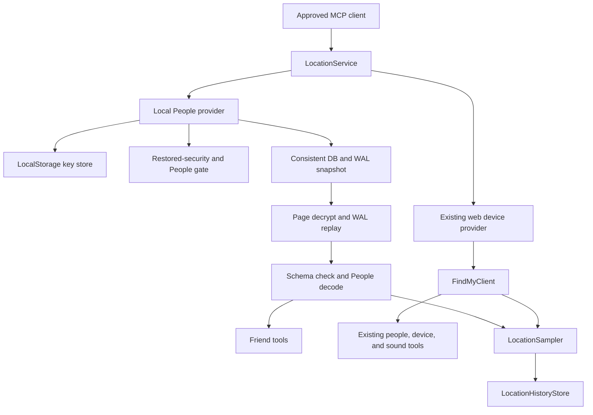
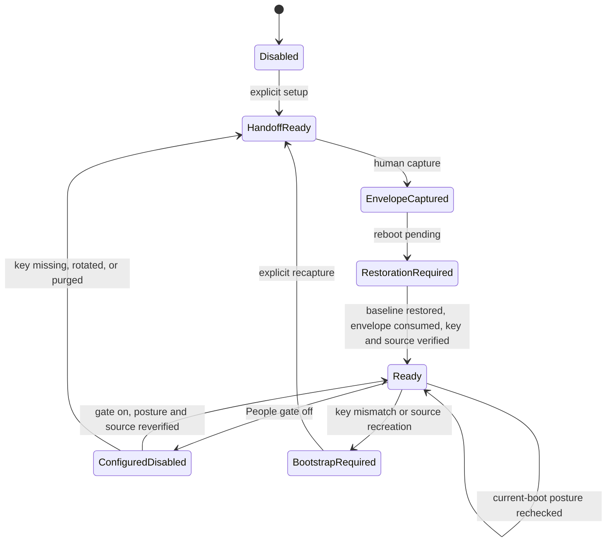
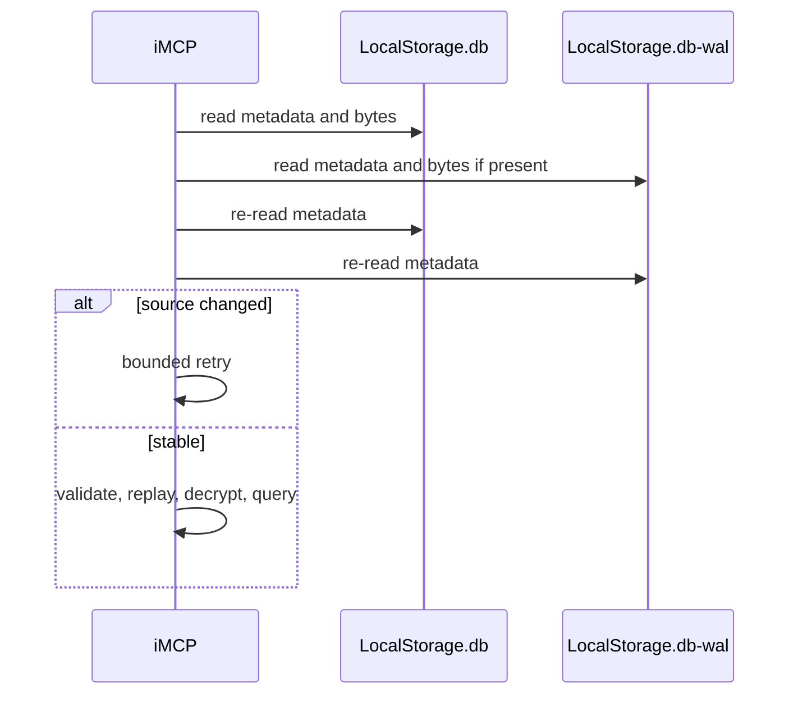

# Find My People - Plan

## Goal Capsule

- **Objective:** iMCP can report and record the precise current locations of people who already share with the signed-in macOS user, while preserving its existing Find My device capabilities.
- **Means:** Decrypt the local `findmylocateagent` `LocalStorage.db` and committed WAL frames with a separately captured 32-byte key (KTD1, KTD2).
- **Authority:** User-settled product requirements and safety boundaries override implementation convenience; current repository behavior governs unchanged device features.
- **Execution profile:** Deep, privacy-sensitive macOS feature with fixture-first characterization and a human-gated machine-security proof.
- **Stop conditions:** Stop on an unsupported database format, unverifiable key, inconsistent source snapshot, or any design that requires weakened macOS security during routine operation.
- **Tail ownership:** The implementation owns code, tests, bootstrap tooling, documentation, PR delivery, and CI. The user owns Recovery entry, reboots, and the one live key-capture proof.

---

## Product Contract

### Summary

Add dedicated MCP tools for Find My People, backed by the encrypted local People database and its WAL. Keep the existing iCloud web provider for devices and sound playback, and feed both sources into iMCP's local history where available.

The primary workflow is an approved MCP client answering “where is this person now?” and, when explicitly requested, summarizing that same person's recent locally recorded fixes without confusing a family device owner with a Find My People share. Exact identifier lookup, source fix time, accuracy, and staleness exist to keep that answer attributable and honest; motion and history are supporting context, not separate collection goals.

### Problem Frame

The existing `location_people` tool derives people from Find My device ownership. That covers the signed-in user and some Family Sharing members, but it cannot see arbitrary friends in the Find My People tab. Current macOS stores those consented shares locally in an encrypted database whose freshest records often exist only in the WAL.

Public 2026 implementations establish a workable format and one-time key capture. The remaining product problem is to make normal reads safe, explicit, and durable without weakening SIP, AMFI, or boot policy after bootstrap.

### Key Decisions

- **Local database is the People source.** Web FMF, IDS, private entitlement injection, and UI scraping are not production fallbacks. (session-settled: user-approved — chosen over web, IDS, injection, and UI scraping: LocalStorage has the strongest current evidence for exact coordinates and ordinary restored-security runtime) Governs R1, R2, R3, R8.
- **Temporary machine-security weakening is allowed only for bootstrap.** (session-settled: user-directed — chosen over omitting precise People support: the user accepts one controlled key-capture window) Governs R5, R6, R10.
- **All four agreed phases are in scope.** The implementation includes the reader, controlled proof workflow, product hardening, and bounded observability support. (session-settled: user-approved — chosen over shipping only a parser prototype: the user approved full implementation) Governs R1 through R12.

### Requirements

**People tools**

- R1. `location_friends` returns every readable Find My People share with an app-derived opaque identifier, display name, coordinates, horizontal accuracy, fix timestamp, fix age, staleness, motion fields when present, and source.
- R2. `location_friend` resolves one share by stable identifier or an unambiguous case-insensitive name and reports ambiguity instead of guessing.
- R3. Missing keys, inaccessible files, wrong keys, inconsistent snapshots, unsupported schemas, and malformed records produce distinct sanitized outcomes. A valid zero-row `location_friends` read returns an empty list; a missing `location_friend` lookup returns not found.
- R4. Existing `location_people`, `location_devices`, `location_ring`, named-place, visit, and iCloud sign-in behavior remains available and source-compatible.

**Security and privacy**

- R5. Routine People reads are local, read-only, unattended, and require no debugger, privilege escalation, daemon mutation, security-policy change, or secret output.
- R6. The expert bootstrap captures only the required key into a one-time device-bound encrypted envelope, then requires post-reboot proof that the complete pre-change security posture is restored before iMCP imports it.
- R7. The database key and friend-identity secret use separate non-synchronizable, this-device-only stores; neither is returned by MCP, logged, staged as plaintext, or included in fixtures and diagnostics.

**Data correctness and lifecycle**

- R8. The reader supports both known database locations, reconstructs the last committed state from the main database plus WAL, detects concurrent replacement or mutation, and never writes to Apple's files.
- R9. Friend samples use the app-derived opaque identifier as durable identity for the lifetime of Apple's underlying server identifier, preserve Apple's original fix time, remain idempotent, and obey a separate default-off People exposure and history gate under the existing Location toggle. A changed server identifier after re-sharing deliberately starts a new subject rather than guessing an identity merge.
- R10. The restored-security proof compares iMCP against native Find My in one bounded observation window, survives a reboot, and exercises Find My open, closed, locked, stale, stopped-sharing, and key-rotation states.

**Operations and research**

- R11. Logs expose only coarse health facts such as chosen path class, schema fingerprint, WAL state, row count, last-success time, and sanitized error category.
- R12. Bounded diagnostics can correlate Find My activity with database and WAL changes without exposing coordinates, names, handles, identifiers, or key material; IDS remains outside the runtime dependency graph.

### Success Criteria

- A real MCP call returns the user's consented non-family People shares with coordinates and timestamps after security has been restored and the separate People gate is enabled.
- A caller can select the correct source from tool descriptions, resolve one friend without name guessing, and distinguish a current fix from stale or historical context.
- A rebooted app continues reading with SIP enabled and no AMFI bypass boot argument.
- Fixture tests prove WAL-only freshness, schema/key failures, concurrent-read handling, stable identity, and sanitized errors.
- Existing device, sound, history, visit, and named-place tests continue to pass.

### Actors

- A1. The user performs the explicit Recovery, reboot, key-capture, and restoration steps.
- A2. The installed iMCP app imports and protects the captured key, reads local People state, and records history.
- A3. An approved MCP client reads People and friend-derived history only when both Location and the separate People gate are enabled.
- A4. Apple's `findmylocateagent` owns and mutates the encrypted source database.

### Key Flows

- F1. **Bootstrap.** A2 first creates a device-bound one-time handoff; A1 captures an encrypted key envelope in a temporary weakened-security window, restores security, reboots, verifies the complete baseline, then lets A2 consume the envelope. Covers R5, R6, R7, R10.
- F2. **People read.** A3 calls a friend tool; A2 snapshots and validates the Apple source, decrypts committed pages, validates schema, decodes records, and returns sanitized models. Covers R1, R2, R3, R8.
- F3. **History sampling.** While Location is enabled, A2 polls the available web-device provider; it polls local People only while the separate People gate is also enabled. Both sources store new fix timestamps idempotently. Covers R4, R9.
- F4. **Recovery.** A key or schema mismatch disables current and historical People reads and supplies remediation while web-device tools and device-only history remain available. Covers R3, R4, R7.

### Acceptance Examples

- AE1. **Covers R1, R8.** Given a valid main database whose newest friend fix exists in a committed WAL frame, when `location_friends` runs, then the WAL value and Apple's fix timestamp are returned.
- AE2. **Covers R2.** Given two friends with the same display name, when the name is passed to `location_friend`, then the tool returns an ambiguity error containing safe disambiguation data and accepts either stable identifier.
- AE3. **Covers R3, R4.** Given a missing or rotated local key and a valid web session, when friend and device tools run, then the friend tool explains bootstrap remediation and the device tool still succeeds.
- AE4. **Covers R5, R6, R10.** Given an encrypted capture envelope and a reboot into the verified pre-change security posture, when the installed app imports the key and reads People, then the envelope cannot be replayed, no debugger or bypass is active, and results match native Find My.
- AE5. **Covers R9.** Given repeated reads of one unchanged friend fix, when the sampler runs twice, then history stores one row under the stable People identifier and retains the current display name.

### Scope Boundaries

**In scope**

- Reader, WAL validation, schema detection, key persistence/import, People MCP tools, sampling/history integration, UI health/setup state, bootstrap and restoration tooling, fixtures, privacy audit, and live-proof instructions.

**Deferred to Follow-Up Work**

- Per-client Location scopes, automatic key rotation, and a maintained macOS compatibility matrix.
- A pure-software IDS client or a safer key-provenance discovery.

**Launch posture**

- Find My People ships as an expert preview supported only on the exact macOS build proven in the setup record. An OS update, account/source recreation, or key rotation may temporarily break reads or require recapture. Removing the preview label requires a maintained compatibility policy and evidence across supported macOS builds.

**Outside this product's identity**

- Reading people who have not shared their location with the signed-in user.
- Automatic Recovery control, SIP changes, AMFI changes, password entry, or raw-key MCP tools.
- Permanent private-framework injection or a runtime that requires weakened boot security.

---

## Planning Contract

### Key Technical Decisions

- KTD1. **Use a separate local People provider beside the web device provider.** `location_friends` and `location_friend` use LocalStorage; existing device-derived `location_people`, `location_devices`, and `location_ring` retain `FindMyClient`. The sampler composes both providers without coupling their readiness. (session-settled: user-approved — chosen over replacing the working web device route: the agreed plan adds arbitrary friends without regressing existing device support) Implements R1, R4, R9.
- KTD2. **Adapt the MIT-licensed page codec and hardened WAL rules with attribution.** Use the verified AES-256 keystream-XOR page format and committed-frame, salt, page-bound, and torn-tail validation from the pinned FindMySyncPlus implementation. Add iMCP-specific consistency retries and schema validation. (session-settled: user-approved — chosen over inventing a new cipher implementation without prior-art tests: current working projects provide reproducible format evidence) Implements R3, R8.
- KTD3. **Capture ciphertext through a bounded raw-file protocol.** Hold read-only descriptors while reading, compare device, inode, size, high-resolution timestamps, headers, and pathname identity before and after, and require an identical strong fingerprint when metadata cannot exclude same-size mutation. Replay only a matching-salt WAL generation through its last checksum-valid commit; retry on checkpoint, replacement, or mutation. Never open, checkpoint, or mutate Apple's database with SQLite. Implements R5, R8.
- KTD4. **Use explicit schema capability checks.** Require `friends`, `secureLocations`, their join columns, and a decodable location plist. Isolate malformed rows, but fail the whole read when the required schema is absent. Implements R3, R8.
- KTD5. **Import through a device-bound encrypted handoff into a dedicated Keychain store.** The app creates the non-exportable handoff key before capture; the extractor emits only an authenticated envelope; after restored-security verification the app consumes it once, validates key length, page-zero magic, and schema, then atomically replaces the prior non-synchronizable this-device-only item. Failed replacement preserves the last valid key. Implements R6, R7.
- KTD6. **Migrate history to provider-scoped subject identity.** Derive an opaque friend ID by HMACing Apple's server identifier with a distinct installation secret. Add provider, subject ID, subject kind, and nullable source-device fields while preserving legacy device rows. Dedupe friends by provider, subject ID, and fix timestamp; filter and group history by stable identity rather than display name. Implements R7, R9.
- KTD7. **Keep bootstrap human-gated and separate from app runtime.** Vendor or adapt only guarded MIT extractor support under `Scripts/`; never invoke it from MCP or the app. The workflow records pre-state, avoids secret stdout, verifies key output, and refuses to call restoration complete without post-reboot checks. (session-settled: user-directed — chosen over bundling ongoing injection: temporary weakening is acceptable but routine operation must return to stock security) Implements R5, R6, R10.
- KTD8. **Expose provider health without private payloads.** One provider-aware readiness model gives web and People independent health plus ordered remediation actions for service activation, Settings, and Grant Access. People readiness consumes a signed, device-bound, current-boot restoration receipt produced by the independent verifier and treats missing or invalid receipts as unknown, never ready. Logging and optional diagnostics use counts and timestamps only. Implements R3, R11, R12.
- KTD9. **Keep decrypted SQLite memory-only.** Reconstruct the bounded database image in memory and query it through SQLite deserialization with disk-backed temporary storage disabled. If the system API cannot support that boundary, stop at a feasibility gate and choose a custom read-only VFS or direct parser; never write plaintext pages, journals, or databases to disk. Implements R5, R7, R8.
- KTD10. **Add a separate default-off People capability gate.** Importing a key does not expose current or historical friend data. Settings must disclose that every approved MCP client can read enabled People tools and derived history. Disabling the gate stops sampling and blocks current and historical friend queries while preserving device tools; a friend-only purge removes persisted friend rows. Implements R5, R9.

### High-Level Technical Design

### Assumptions

- The per-Mac key remains usable across ordinary reboots; account reset, OS update, or database recreation may require recapture.
- Full Disk Access is the reliable production permission path for iMCP's unsandboxed installed app; folder-picker access may be added only if live testing proves it more reliable.
- Apple's cache refresh cadence is not controllable. `refresh` on friend tools means re-read local state, not wake a friend's device.
- Synthetic fixtures derived from the published codec are sufficient for automated tests; no real names, identifiers, coordinates, keys, envelopes, or live MCP output enter the repository.
- Frozen non-sensitive known-answer vectors generated by the pinned upstream implementation provide independent codec and WAL expectations; iMCP's own fixture generator is not its sole oracle.

### System-Wide Impact

- Location activation can no longer mean only “web iCloud signed in.” Service health and UI must represent web-device and local-People readiness independently.
- All approved MCP clients with both Location and the separate People gate enabled can read highly sensitive friend coordinates. The existing pairing gate remains the authorization boundary; per-client scopes are deferred.
- A new default-off People gate prevents existing approved clients from silently inheriting friend access; per-client scopes remain deferred.
- History and named-place features gain non-family people through a migrated provider-scoped identity, separate purge, unchanged retention, and local-only storage.
- Release signing, entitlements, setup documentation, and privacy text must account for the protected Find My source and imported key.

### Risks and Dependencies

- Apple can change the codec, schema, path, or key lifecycle without notice. Fail closed and make the schema fingerprint diagnosable.
- WAL files can change during a read. Bounded consistency retries and committed-generation validation prevent torn reconstruction.
- The bootstrap can leave the machine weakened after interruption. Scripts cannot restore Recovery state automatically, so the workflow must make restoration and independent verification unavoidable.
- A captured key can survive the reboot as reusable plaintext. The device-bound authenticated envelope and one-time import eliminate that staging path.
- Decrypted pages can leak through temp files, journals, crash artifacts, or logs. Memory-only reconstruction, strict size bounds, no disk-backed SQLite temp storage, and artifact scans mitigate this.
- Reverse-engineered sources are MIT licensed but still require retained attribution. Pin the researched commits in comments or documentation.
- Live proof depends on the user's Recovery actions and current consented shares; automated CI cannot establish it.

### Sources and Research

- `App/Services/Location.swift`, `App/Services/Location/LocationSampler.swift`, `App/Services/Location/LocationHistoryStore.swift`, and `App/Services/Location/FindMyClient.swift` define the current tool, provider, sampler, and history seams.
- `App/Services/Location/ICloudCredentialStorage.swift` and `App/Shared/SecretFileStore.swift` define the repository's secret-state and DEBUG storage patterns.
- `docs/solutions/conventions/agents-md-is-source-of-truth.md` requires durable operational guidance to live in `AGENTS.md` or a solution document rather than `CLAUDE.md`.
- FindMySyncPlus commit `0b8a5fbbeb96dc90313a09a946df22c0a67190bd` provides the MIT-licensed codec, dual-path logic, and hardened WAL tests.
- FollowMyFriends commit `967a82e5af6f4d0e8742136b5fb728d9191f8f46` independently confirms the native menu-bar read path and refresh behavior.
- findmy-key-extractor commit `3797fbb99e033a474b5c3ef54a60601cc24ee7b1` documents the MIT-licensed `sqlite3_key_v2` capture and restored-security workflow.

---

## Implementation Units

### U1. Characterize and implement the encrypted source reader

- **Goal:** Produce typed friend snapshots from consistent encrypted DB and WAL bytes.
- **Requirements:** R1, R3, R8.
- **Dependencies:** None.
- **Files:** `App/Services/Location/LocalStoragePeopleProvider.swift`, `iMCPTests/ICloudAuthFlowTests.swift`, `LICENSE.md`.
- **Approach:**
  1. Add provider-neutral friend/fix models and client-facing error categories.
  2. Import unchanged, non-sensitive known-answer ciphertext/plaintext database and WAL vectors generated by the pinned upstream implementation and verify those before adapting the Swift codec.
  3. First prove that the shipped SQLite supports bounded, read-only in-memory deserialization with disk-backed temp storage disabled. If it does not, stop schema work and record the selected custom read-only VFS or direct-parser fallback; plaintext database or journal files are forbidden.
  4. Adapt the pinned MIT codec, committed WAL parser, dual-path resolution, bounded snapshot retry, schema validation, plist decoding, and stable sorting.
  5. Keep raw paths, SQL errors, records, and key material below the sanitized error boundary. Treat a source over the configured memory limit as a distinct compatibility error; derive the supported-build limit from sanitized live size observations with documented headroom.
- **Execution note:** Start with synthetic encryption and WAL characterization tests before implementing the reader.
- **Patterns to follow:** `FindMyClient` typed models, `CallHistory.swift` protected-source handling, and `ToolErrorResponse.swift` sanitization.
- **Test scenarios:**
  - Covers AE1. A fixture whose newest fix is only in a committed WAL frame returns that value.
  - Correct key decrypts page zero; a wrong or wrong-length key produces distinct errors.
  - Uncommitted, torn, stale-salt, zero-page, and out-of-range WAL frames are rejected without unbounded allocation.
  - A source mutation during capture retries and then succeeds or returns an inconsistent-snapshot error.
  - Both known database paths resolve by valid decryption and freshness rather than existence alone.
  - Missing tables or columns fail as unsupported schema; malformed optional rows are isolated.
  - Instrumented file opens prove read-only access; fixture hashes prove the reader never mutates its inputs. Live Apple file hashes are diagnostic evidence only because Apple's writer may legitimately mutate them concurrently.
  - Deserialization works without a plaintext database or disk-backed SQLite temporary file and rejects images over the configured size bound.
- **Verification:** Synthetic fixtures produce exact expected identifiers, coordinates, accuracy, timestamps, motion fields, and safe failure categories.

### U5. Build the guarded bootstrap and restoration workflow

- **Goal:** Make the approved one-time key capture repeatable while preventing plaintext staging and requiring complete machine-security restoration.
- **Requirements:** R5, R6, R7, R10.
- **Dependencies:** U1, U2. Execute after U2's handoff and readiness primitives; implementation order is U1, U2, U5, U3, U4, U6.
- **Files:** `App/Services/Location/FindMyPeopleBootstrap.swift`, `Scripts/find-my-people-bootstrap.sh`, `Scripts/find_my_people_key.py`, `Scripts/verify-find-my-people-security.sh`, `docs/find-my-people-setup.md`, `AGENTS.md`, `LICENSE.md`, `iMCPTests/ICloudAuthFlowTests.swift`.
- **Approach:**
  1. Adapt only the LocalStorage `sqlite3_key_v2` capture from the pinned MIT extractor and require the canonical Apple process and database identity.
  2. Let the app create the non-exportable key agreement key, capture the pre-change posture into device-bound Keychain state, and bind that baseline digest plus installation identity into a one-time public-key handoff. Reject missing, replaced, modified, replayed, or cross-installation baselines and envelopes.
  3. Emit only an authenticated, device-bound envelope with no network fetch or persistent helper while security is weakened.
  4. Require a minimum safe baseline before capture and after reboot: Full Security, fully enabled SIP, authenticated root enabled, and no debugger/AMFI bypass or weakening boot argument. Also require equivalence for Developer Mode and any other touched setting.
  5. Have the independent verifier sign a current-boot restoration receipt bound to the baseline and envelope. The app verifies and consumes this receipt before key import; reboot or boot-policy change invalidates readiness until reverification.
  6. Add status and dry-run modes, private temporary output, cleanup traps, strict timeouts, and no secret stdout.
- **Patterns to follow:** `Scripts/install-local.sh` and `Scripts/verify-app-signing.sh` controlled-mutation and verification style.
- **Test scenarios:**
  - Script syntax and dry-run checks pass without sudo, debugger attachment, process mutation, network fetch, or key output.
  - Wrong process, wrong database, multiple candidates, timeout, unexpected security state, or modified envelope aborts.
  - Captured artifacts are unusable on another Mac and consumed envelopes cannot be replayed.
  - Interrupted capture leaves no plaintext key, repository artifact, persistent helper, or false restoration receipt.
  - Covers AE4. Each weakened baseline fact is independently rejected until the current boot matches the recorded pre-state.
- **Verification:** The documented workflow has explicit prepare, entry, capture, restore, reboot, verify, one-time import, and rollback checkpoints; only A1 executes privileged steps.

### U2. Add secure key import and independent Location readiness

- **Goal:** Let the installed app validate and protect the extracted key while representing People and device readiness separately.
- **Requirements:** R3, R4, R5, R6, R7.
- **Dependencies:** U1. U2 owns handoff/readiness primitives; U5 subsequently owns the external capture and restoration workflow.
- **Files:** `App/Services/Location/LocalStorageKeyStorage.swift`, `App/Services/Location/FindMyPeopleReadiness.swift`, `App/Services/Location.swift`, `App/Controllers/ServiceRegistry.swift`, `App/Views/SettingsView.swift`, `App/App.entitlements`, `App/App.Debug.entitlements`, `Scripts/verify-app-signing.sh`, `iMCPTests/ICloudAuthPlumbingTests.swift`, `iMCPTests/ICloudAuthFlowTests.swift`.
- **Approach:**
  1. Add missing/data/unavailable key states, one-time envelope consumption, atomic validated replacement, removal, and a distinct installation identity secret.
     If that identity secret becomes unavailable while friend history exists, block People sampling and friend-history lookup without modifying stored rows; recovery explicitly purges old friend history before generating a new identity.
  2. Centralize web-device and local-People health, current-boot restoration evidence, and the default-off People capability in one readiness actor observed by tools, sampler, Settings, service activation, and Grant Access.
  3. Give the readiness actor ordered remediation actions: iCloud sign-in for web devices; enable People; complete restored-security verification; import a valid envelope; grant Full Disk Access; or recapture a missing/rotated key.
  4. Treat Location as active only when the web provider is ready or when local People is ready and the People gate is enabled. One provider's failure remains non-global.
  5. Route source access through an actual Full Disk Access readability probe and keep iCloud sign-in for device capabilities.
  6. Make Location the parent Settings capability and People a default-off subordinate control. When Location is off, retain but visually disable the People preference and explain that re-enabling Location resumes configured providers; when setup is incomplete, the People row shows the next remediation instead of an effective-on state.
  7. Define setup interactions by state: `Not configured` offers Prepare Setup; `Handoff ready` offers Show Instructions and Cancel; `Restoration required` offers Verify Restored Security; `Envelope ready` offers Import; `Configured, disabled` offers Enable People; `Ready` shows source freshness and Disable. Every async action has progress, cancellation before mutation, sanitized failure, and retry without losing a previously valid key.
- **Patterns to follow:** `ICloudCredentialStorage`, `SecretFileStore`, `FullDiskAccess`, and the existing settings permission rows.
- **Test scenarios:**
  - Missing, inaccessible, corrupt, wrong-length, wrong-key, round-trip, replacement, and clear states remain distinct.
  - Covers AE3. People can be unavailable while web devices remain usable, and vice versa.
  - Key import persists only after restored-security, source, and schema verification; a failed replacement preserves the prior valid key.
  - Existing paired clients cannot read current or historical friend data until the separate People gate is enabled.
  - Keychain tests establish this-device-only, non-synchronizing behavior and deny the bundled CLI or an unrelated process.
  - Location activation succeeds when web devices are ready or People is both ready and enabled; configured-but-disabled People remains non-active when no web provider is ready.
  - Debug and Release entitlements stay aligned and signing verification covers the added read-only path.
- **Verification:** Settings truthfully shows independent source health, and production key operations use the installed app's Keychain identity.

### U3. Expose friend MCP tools without regressing device tools

- **Goal:** Add composable friend list and lookup tools backed only by LocalStorage.
- **Requirements:** R1, R2, R3, R4, R5.
- **Dependencies:** U1, U2.
- **Files:** `App/Services/Location.swift`, `iMCPTests/ICloudAuthFlowTests.swift`, `README.md`.
- **Approach:**
  1. Add `location_friends` and `location_friend` with static schemas and read-only annotations.
  2. Preserve current `location_people`, `location_devices`, and `location_ring` routing to the web provider.
  3. Cross-reference the tool descriptions: `location_people` is explicitly device-derived family data, while `location_friends` is explicitly the Find My People sharing list.
  4. Define `refresh` as a fresh local snapshot and make exact identifier lookup the ambiguity-safe path.
  5. Enforce the People gate on both current tools and any friend-derived history or named-place operation.
  6. Perform no automatic reverse geocoding or other outbound request; friend tools return only fields derived locally from LocalStorage.
- **Patterns to follow:** Existing Location tool declarations, response encoding, and `ClientFacingError` handling; existing geocoding behavior applies only to unchanged device tools.
- **Test scenarios:**
  - Covers AE1. The list tool returns exact fixture fields and deterministic order.
  - Covers AE2. Identifier lookup succeeds; duplicate-name lookup is rejected with safe disambiguation.
  - Covers AE3. Local provider failures do not change web device tool results.
  - Empty valid database returns an empty list, while decrypt/schema/access failures throw typed errors.
  - Tool schemas remain static before key setup and contain no key import or security mutation action.
- **Verification:** A protocol-level MCP test calls both new tools and existing device tools through the real service registry.

### U4. Migrate and feed friends into bounded local history

- **Goal:** Record People fixes alongside device fixes without name-based identity or duplicate cached samples.
- **Requirements:** R4, R9.
- **Dependencies:** U1, U2.
- **Files:** `App/Services/Location/LocationSampler.swift`, `App/Services/Location/LocationHistoryStore.swift`, `App/Controllers/ICloudSession.swift`, `App/Services/Location.swift`, `App/Views/SettingsView.swift`, `iMCPTests/ICloudAuthFlowTests.swift`.
- **Approach:**
  1. Make the sampler poll available providers independently under one cancellable toggle lifecycle.
  2. Run an additive, versioned migration in one transaction: add provider scope, stable subject ID, subject kind, observed display name, and nullable source-device fields; preserve every legacy device row and index; update `user_version` last; roll back on any schema or copy failure.
  3. Backfill legacy rows as `legacyDevice` without inferring identity from names. Derive friend IDs from provider scope plus HMAC of Apple's server identifier, create a new scope after account/source replacement, and preserve source fix timestamps.
  4. Update filters, visit grouping, named-place lookup, purge, idempotency, and retention to use stable identity while keeping display names mutable metadata. Preserve old-reader behavior where feasible and fail clearly on unsupported downgrade.
  5. Route named-place person resolution through the local People provider by stable identifier or unambiguous name while preserving existing web-person behavior.
  6. Protect the history directory and database with owner-only permissions and document that it contains plaintext derived locations.
  7. Expose Purge People History as a separate destructive action, never as toggle behavior. Confirm the retained device and named-place data and deleted People history, disable repeat activation while running, report sanitized failure without partial UI success, and show an empty People-history summary after completion.
- **Execution note:** Add characterization for the current stop/start and web-session refresh behavior before changing sampler ownership.
- **Patterns to follow:** `LocationSampler` cancellation loop and `LocationHistoryStore.record` idempotent primary key.
- **Test scenarios:**
  - Covers AE5. Two reads of one fix create one history row under the stable friend identifier.
  - Two friends with identical names remain distinct; a display-name change keeps identifier continuity.
  - Named-place creation resolves a non-family friend by identifier or unambiguous name without changing web-person routing.
  - Migration preserves legacy device rows exactly, is idempotent, and rolls back without partial schema changes on injected failure.
  - A local People error does not prevent valid web-device samples from recording, and a web error does not prevent People samples.
  - Turning Location off stops both providers immediately; turning it on restarts configured providers.
  - Stale Apple fixes retain their original timestamps and do not become current sampler timestamps.
  - Disabling People blocks old friend history and stops sampling; friend-only purge removes People rows while preserving device rows and named places.
- **Verification:** History, visits, and named-place tests pass for device and friend samples with unchanged 90-day retention.

### U6. Harden operations and prepare the live proof

- **Goal:** Make schema drift, refresh behavior, privacy, and the user-run live proof diagnosable without private payloads.
- **Requirements:** R10, R11, R12.
- **Dependencies:** U1 through U5.
- **Files:** `App/Services/Location/LocalStoragePeopleProvider.swift`, `App/Views/SettingsView.swift`, `Scripts/observe-find-my-people.sh`, `docs/find-my-people-setup.md`, `docs/solutions/integrations/find-my-people-local-storage.md`, `README.md`, `iMCPTests/ICloudAuthFlowTests.swift`.
- **Approach:**
  1. Add coarse provider health and last-success state to Settings and logs.
  2. Add a metadata-only observer for DB/WAL generation changes and relevant subsystem activity.
  3. Document the live matrix, native Find My comparison, reboot proof, key-rotation behavior, privacy audit, and known macOS build.
  4. Characterize stopped-then-restored sharing. If Apple's server identifier changes, report a deliberate new subject and disclosed history split rather than merging by name.
  5. Define native parity as the same active share set with corresponding source timestamps and coordinates within reported horizontal accuracy plus a documented tolerance; classify ordinary cache lag separately from decode mismatch. Record only sanitized DB/WAL sizes and use them to set the supported-build memory bound with explicit headroom.
- **Patterns to follow:** `Logger.service`, settings history summary, and solution frontmatter conventions.
- **Test scenarios:**
  - Logs and diagnostics contain no coordinates, names, handles, stable IDs, key bytes, decrypted blobs, SQL, or absolute user paths.
  - Observer output changes when fixture file metadata changes and remains payload-blind.
  - Unknown schema and key rotation surface safe health states while prior history remains readable.
  - The live-proof checklist distinguishes automated fixture proof from user-observed native parity.
  - Filesystem and artifact canaries prove no plaintext database, key, envelope plaintext, or real friend payload reaches temp files, test bundles, crash reports, staged diff, commits, or PR text.
- **Verification:** Automated privacy scans pass and the setup guide is sufficient for the user to complete the one remaining Recovery/reboot proof without agent improvisation.

---

## Verification Contract

| Gate | Applies to | Done signal |
|---|---|---|
| `swift format -i -r .` then `swift format lint --strict --recursive .` | U1-U6 | All Swift is formatted and the strict lint gate passes. |
| `xcodebuild -quiet -scheme iMCP -configuration Debug -destination "platform=macOS" build` | U1-U6 | App and bundled CLI compile with warnings as errors. |
| `xcodebuild test -scheme imcp-serverTests -destination "platform=macOS"` | U3 | Existing CLI/protocol tests pass. |
| `xcodebuild test -scheme iMCP -destination "platform=macOS"` | U1-U6 | Existing and new app tests pass, including codec, WAL, key, MCP, sampler, history, and privacy cases. |
| Script syntax, dry-run, and fixture verification | U5-U6 | No privileged or destructive action occurs in automated verification; outputs contain no key material. |
| Installed-app signing verification | U2, U5 | Debug/Release entitlement expectations remain aligned and installed signature checks pass. |
| User-run restored-security proof | U5-U6 | After reboot, the full recorded security baseline matches, `location_friends` matches native Find My in the same observation window, and a second reboot still works. |
| Privacy artifact scan | U1-U6 | Seeded canaries prove keys, plaintext pages, real identities, coordinates, MCP output, and envelopes do not enter temp storage, logs, test bundles, crash artifacts, git content, or PR text. |

Before app tests, stop the live installed app and active clients that own the listener endpoint or Bonjour service. A green fixture suite is not the live proof; record the restored-security comparison separately.

---

## Definition of Done

- Every R-ID is implemented or explicitly reported as blocked by the user-run Recovery proof.
- U1-U6 code, tests, scripts, documentation, attribution, and sanitized diagnostics are present with no abandoned experimental paths.
- `location_friends` and `location_friend` work through the real MCP service boundary against synthetic fixtures.
- Existing web device tools and existing history behavior have regression coverage.
- Routine app runtime is read-only, creates no plaintext SQLite artifact, and contains no path that changes SIP, AMFI, boot policy, or Apple daemon state.
- No secret or real friend data exists in source, tests, logs, diagnostics, commit history, or PR text.
- Formatting, build, CLI tests, app tests, signing checks, and safe script checks pass.
- The PR states that live People parity remains unproven until the user completes the documented Recovery, reboot, restoration, and native-comparison checklist.
